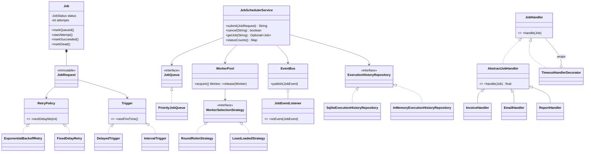

# Job Scheduling and Resource Allocation Engine

A small version of the background-job systems companies use (Celery, Sidekiq, Quartz, Hangfire), written in **plain Java 17** with a focus on **OOP, SOLID and design patterns**.

Imagine a company that has to process **5,000 invoices**, **2,000 email notifications** and **500 report-generation tasks**.
This engine decides **what runs first**, **which worker runs it**, and **what happens when a task fails**.

  

---

## Features

| # | Requirement | How it works | Where |
|---|---|---|---|
| 1 | **Job submission & registration** | `JobRequest` builder, handler per job type, custom or generated ids, cancel | `api/JobSchedulerService`, `handler/JobHandlerRegistry` |
| 2 | **Priority-based scheduling** | CRITICAL > HIGH > MEDIUM > LOW, FIFO for ties, **aging** so LOW jobs never starve | `queue/PriorityJobQueue` |
| 3 | **Worker management** | Fixed worker pool, pluggable selection (Round Robin / Least Loaded), busy-time tracking | `worker/*` |
| 4 | **Retry failed jobs** | Exponential backoff + jitter (or fixed delay), max retries, **dead letter queue**, non-retryable errors skip retries | `retry/*`, `execution/JobExecutor` |
| 5 | **Job dependencies** | A job waits until all its parents succeed. **Cycle detection** (DFS) at submit time. A failed parent → its children are **skipped** | `dependency/*` |
| 6 | **Scheduled execution** | Run once after a delay, or repeatedly on an interval | `trigger/*` |
| 7 | **Task timeouts** | Each job has a timeout. Stuck jobs are interrupted, marked `TIMED_OUT` and retried | `handler/TimeoutHandlerDecorator` |
| 8 | **Execution history** | Every attempt (worker, duration, result, error) is stored in **SQLite** | `history/*` |
| 9 | **Resource utilization dashboard** | Live web dashboard + console status line: counts, throughput, wait time, worker utilization, DLQ, job lookup | `dashboard/*` |

---

## Run it

**Requirements:** Java 17+ and Maven.

```bash
mvn clean package
java -jar target/job-scheduler.jar
```

Then open **http://localhost:8080**.

Options: `java -jar target/job-scheduler.jar [workers] [port] [--exit]`, for example `java -jar target/job-scheduler.jar 4 9090`.
`--exit` quits after the final summary instead of keeping the dashboard running.

### What the demo does
- Submits **5,000 invoices** (MEDIUM): 500 customers × 10 invoices
- Submits **500 reports** (LOW): each report **depends on** its customer's 10 invoices
- Submits **2,000 emails** (HIGH). They are submitted last but **run first** because of priority
- Schedules a **recurring** "Hourly sales summary" (every 8s, 5 runs) and a **delayed** "Payment reminder" (in 12s)
- Tries to create a **dependency cycle** (A → B → A), which the engine rejects
- Some jobs fail on purpose so you can see every feature:
  - 3–5% random temporary failures → **retried** with backoff
  - 5 invoices with negative amounts → **non-retryable**, go straight to the **DLQ**, and their 5 reports are **skipped**
  - 5 emails to bouncing addresses → fail 4 times → **DLQ**
  - 2% of reports hang → killed by the **timeout** → retried

### Look at the history in SQLite
```bash
sqlite3 data/job_history.db "SELECT status, COUNT(*) FROM job_executions GROUP BY status;"
sqlite3 data/job_history.db "SELECT job_id, attempt, worker_id, status, duration_ms, error FROM job_executions WHERE job_id='EMAIL-0400';"
```

### Run the tests
```bash
mvn test
```

---

## Architecture

```
 submit(JobRequest)
        │
        ▼
 ┌────────────────────┐  has trigger   ┌──────────────────┐
 │ JobSchedulerService│ ─────────────► │ TriggerScheduler │ (delayed / interval)
 │      (Facade)      │                └────────┬─────────┘
 └─────────┬──────────┘  has parents            │ when due
           │ ──────────► DependencyManager ─────┤ when parents succeed
           ▼                                    ▼
             ┌──────────────────────────────────┐
             │ PriorityJobQueue  (heap + aging) │
             └────────────────┬─────────────────┘
                              │ Dispatcher: take job → acquire worker
                              ▼
             ┌──────────────────────────────────┐
             │ WorkerPool  [W01] [W02] … [W08]  │
             └────────────────┬─────────────────┘
                              │ JobExecutor → TimeoutHandlerDecorator → Invoice/Email/ReportHandler
          success ◄───────────┴───────────► failure → RetryPolicy → requeue later  /  DeadLetterQueue
                              │
                     EventBus (Observer)
          ┌───────────────────┼────────────────────┐
   HistoryRecorder     MetricsCollector     DependencyManager
     (SQLite)          (dashboards)         (unblock / skip children)
```

### Job lifecycle (State pattern, `model/JobStatus`)
```
WAITING ──(parents done)──► QUEUED ──► RUNNING ──► SUCCEEDED
   │                          ▲          │
   │                          │          ├──► RETRY_SCHEDULED ──► QUEUED again
   │                          │          └──► DEAD (dead letter queue)
   └──► SKIPPED (parent failed)            any non-final state ──► CANCELLED
```

### Class diagram


---

## OOP & design principles: where to find them

Every place is marked in the code with a tag. To list them all:

```bash
grep -rn "\[OOP\|\[SOLID\|\[Design Pattern" src/main/java
```

### OOP pillars
| Pillar | Example |
|---|---|
| **Encapsulation** | `Job` has no `setStatus()`; state only changes through `markQueued()`, `startAttempt()`, … which reject illegal moves. `Worker.markBusy/markIdle` are package-private, so only `WorkerPool` can call them. |
| **Abstraction** | The engine only knows `JobHandler.handle(job)`, `JobQueue.take()`, `RetryPolicy.nextDelayMs()`. |
| **Inheritance** | `AbstractJobHandler` → `InvoiceHandler`, `EmailHandler`, `ReportHandler` |
| **Polymorphism** | `registry.get(type).handle(job)` runs invoice, email or report logic. Same for retry policies, triggers and worker strategies. |

### SOLID
| Principle | Example |
|---|---|
| **S**ingle Responsibility | `Dispatcher` only matches jobs to workers, `JobExecutor` only runs one attempt, `DependencyManager` only tracks parents, `HistoryRecorder` only saves history |
| **O**pen/Closed | New job type, retry policy, trigger or worker strategy = a new class; the engine is untouched |
| **L**iskov Substitution | Any `RetryPolicy`, `Trigger` or `ExecutionHistoryRepository` can be swapped in (SQLite ↔ in-memory in tests) |
| **I**nterface Segregation | `JobEventListener` has one method, `JobHandler` has two |
| **D**ependency Inversion | `JobSchedulerService` receives the registry, history repository, worker strategy and `Clock` through its constructor |

### Design patterns
| Pattern | Class |
|---|---|
| **Facade** | `JobSchedulerService` |
| **Builder** | `JobRequest.Builder` |
| **Strategy** | `RetryPolicy`, `WorkerSelectionStrategy`, `Trigger` |
| **State** | `JobStatus.canMoveTo()` + `Job` |
| **Template Method** | `AbstractJobHandler.handle()` = `validate()` → `execute()` |
| **Decorator** | `TimeoutHandlerDecorator` |
| **Observer** | `EventBus` + `MetricsCollector`, `HistoryRecorder`, `DependencyManager` |
| **Registry / Factory** | `JobHandlerRegistry` |
| **Repository** | `ExecutionHistoryRepository` (SQLite / in-memory) |
| **Object Pool** | `WorkerPool` |
| **Producer–Consumer** | `submit()` → `PriorityJobQueue` → `Dispatcher` |

---

## Project structure
```
src/main/java/com/jobscheduler
├── Main.java                 # starts engine + dashboards + demo
├── api/                      # JobSchedulerService (Facade), SchedulerConfig
├── model/                    # Job, JobRequest (Builder), JobStatus (State), Priority, JobExecution
├── queue/                    # JobQueue, PriorityJobQueue (heap + aging)
├── worker/                   # Worker, WorkerPool, RoundRobin / LeastLoaded strategies
├── handler/                  # JobHandler, AbstractJobHandler, Invoice/Email/Report, TimeoutHandlerDecorator
├── execution/                # Dispatcher, JobExecutor
├── retry/                    # RetryPolicy, ExponentialBackoffRetry, FixedDelayRetry, DeadLetterQueue
├── dependency/               # DependencyManager, CycleDetector
├── trigger/                  # Trigger, DelayedTrigger, IntervalTrigger, TriggerScheduler
├── events/                   # EventBus, JobEvent, JobEventListener
├── history/                  # ExecutionHistoryRepository, SQLite + in-memory, HistoryRecorder
├── metrics/                  # MetricsCollector
├── dashboard/                # WebDashboard (JDK HttpServer), ConsoleDashboard, Json
└── demo/                     # DemoWorkload (the 5,000 / 2,000 / 500 scenario)
src/main/resources/dashboard/index.html
src/test/java/...             # 23 unit + integration tests
```

## Tech choices
- **Java 17, no frameworks.** The point is to show the design, not a framework's magic.
- **SQLite** for history: an embedded single-file database with real SQL and zero setup. Moving to PostgreSQL means writing one new `ExecutionHistoryRepository` class.
- **JDK `HttpServer`** for the dashboard: no Spring needed.
- **`java.time.Clock` injected** so tests control time.

## Possible extensions
- Cron expressions (`CronTrigger`) as one new `Trigger` class
- Re-run jobs from the dead letter queue via the dashboard
- Scale workers up and down at runtime
- Persist the queue itself (survive restarts)
- Per-team quotas / fair-share scheduling as a new queue strategy
